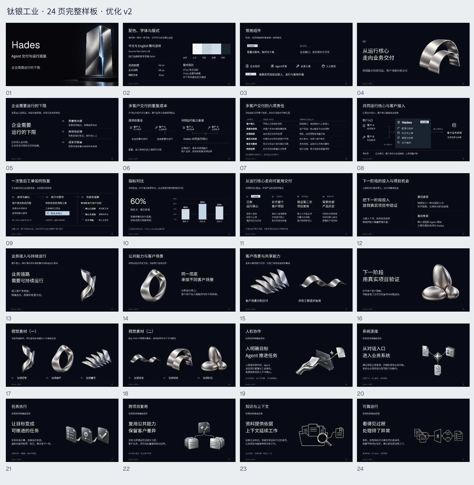
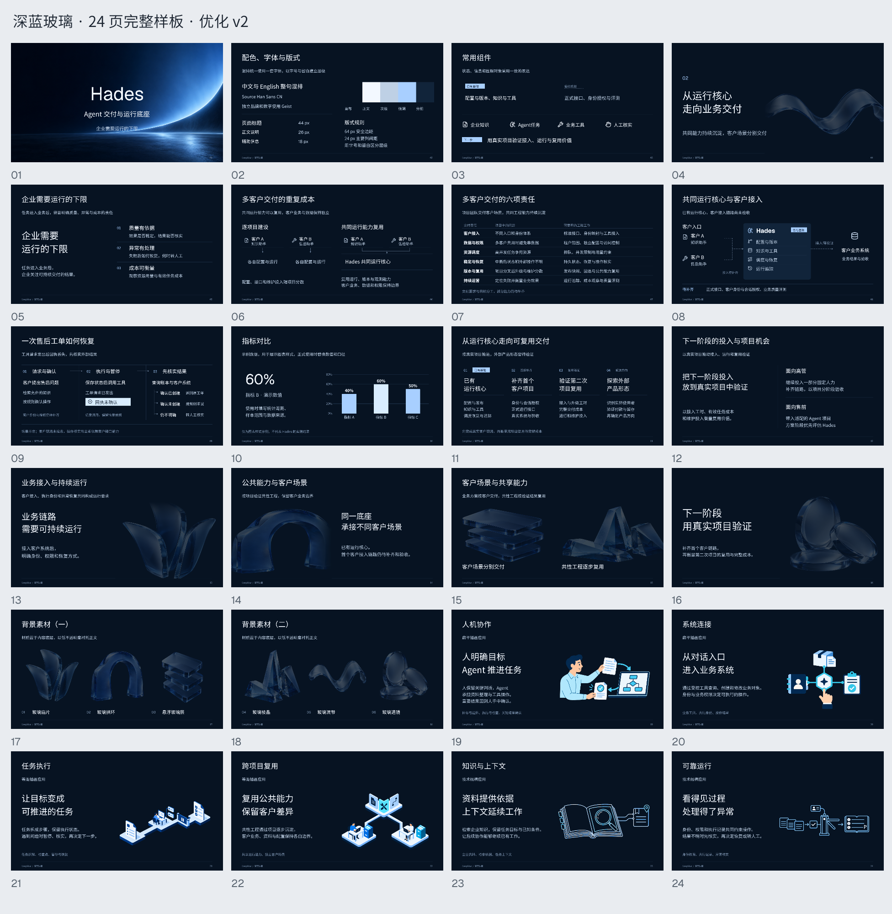
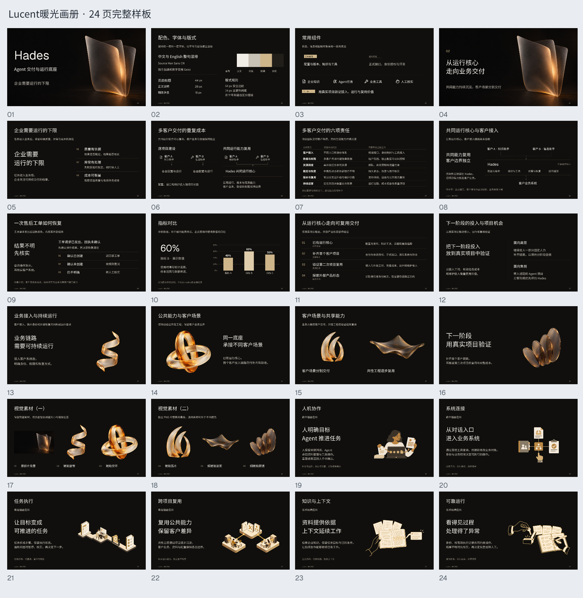
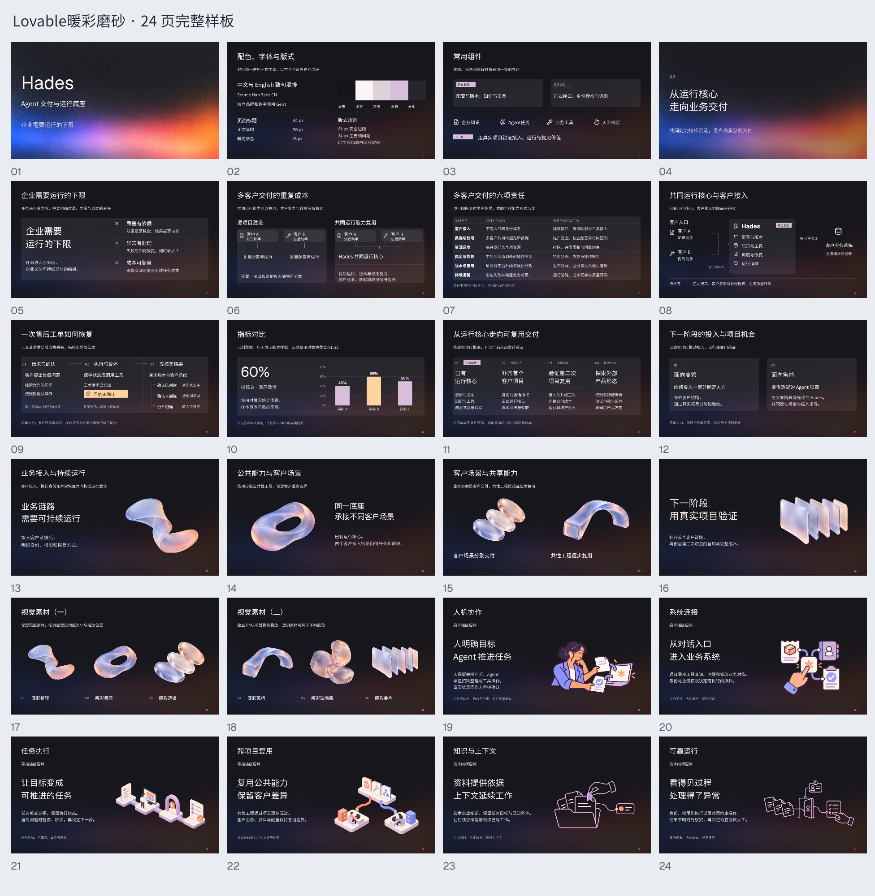
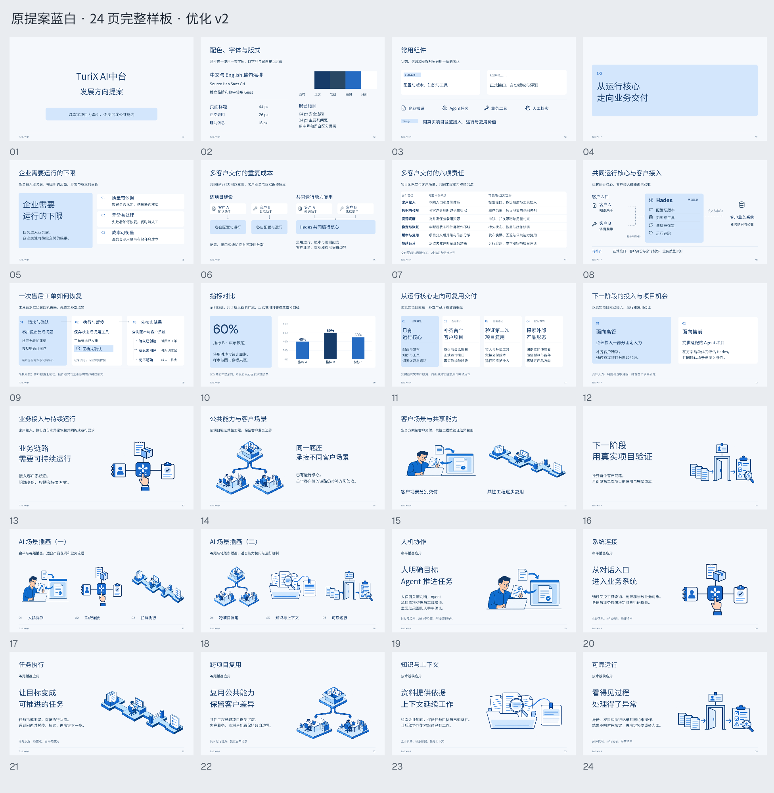

# ppt-templates

用于 AI 科技、产品宣讲和企业方案汇报的五套 PowerPoint 样板。每套 24 页，包含常用正文版式、组件、业务图解和配套素材。

## 选择模板

| 风格 | 视觉方向 | 下载与预览 |
| --- | --- | --- |
| 钛银工业 | 银灰材质、浅浮雕和银线插画 | [PPTX](templates/titanium-industrial/template.pptx) · [24 页总览](templates/titanium-industrial/preview.png) |
| 深蓝玻璃 | 深蓝底色、低亮度玻璃背景 | [PPTX](templates/deep-blue-glass/template.pptx) · [24 页总览](templates/deep-blue-glass/preview.png) |
| Lucent 暖光画册 | 暖黑底色、琥珀暖光与画册留白 | [PPTX](templates/lucent/template.pptx) · [24 页总览](templates/lucent/preview.png) |
| Lovable 暖彩磨砂 | 暖彩渐变、磨砂质感 | [PPTX](templates/lovable-frosted/template.pptx) · [24 页总览](templates/lovable-frosted/preview.png) |
| 原提案蓝白 | 蓝白底色、扁平与等距插画为主 | [PPTX](templates/blue-white/template.pptx) · [24 页总览](templates/blue-white/preview.png) |

当前版本：钛银工业、深蓝玻璃、原提案蓝白采用素材优化 v2；Lucent 和 Lovable 使用保留版。仓库每套只收录一个当前版本。

## 页面用途

- 1–4：封面、配色字体与版式规范、常用组件、章节页。
- 5–12：观点说明、前后对比、表格、业务架构、流程与异常、指标图表、阶段路线、行动请求。
- 13–18：主视觉应用、双图对照、收束页及配套素材图库。
- 19–24：人机协作、系统连接、任务执行、跨项目复用、知识与上下文、可靠运行。

每套含一个品牌母版及 24 个命名版式。正文、表格、图表和业务图解可编辑；插画与材质为已嵌入的图片，可替换和等比缩放。图表保留原数据表。

## 使用方法

1. 下载所选主题的 `template.pptx`。
2. 安装 `fonts/` 中的字体，减少字体替换造成的排版变化。PPT 未嵌入字体。
3. 复制适合的页面，并替换业务内容；新增页可从对应命名版式开始。
4. 保持同一主题的母版、配色和字体，优先使用该主题自身的配套素材。

中文及整句中英混排使用 Source Han Sans CN，独立品牌字与数字使用 Geist。字体许可文件在 `fonts/`。

钛银第 19–22 页为银灰浅浮雕，第 23–24 页为银线插画。深蓝第 4、13–18 页的材质采用底层图片与可编辑底色遮罩；复制背景时同时选中图片和遮罩，通过遮罩透明度调整亮度。蓝白第 13–18 页以插画应用和图库为主。

五套画布均为 16:9；蓝白保留原提案的较大画布尺寸。建议在同一主题内复制页面。

## 内容说明

这些文件是版式样板。图表数字为演示数据，示例文字与概念插画需按实际业务替换；其中产品已有能力、后续规划和待验证部分以正文及备注为准。来源说明保留在相应页备注。

## 主题预览

### 钛银工业

### 深蓝玻璃

### Lucent 暖光画册

### Lovable 暖彩磨砂

### 原提案蓝白

